<!-- Generated by scripts/build.mjs from docs/systems.json. Edit those, then run: node scripts/build.mjs -->
<a href="https://naramalhasaniwork.github.io/naramalhasaniWork/"><picture><source media="(prefers-color-scheme: dark)" srcset="assets/map-dark.svg"></picture></a>

  <a href="https://www.naram.co"><picture><source media="(prefers-color-scheme: dark)" srcset="assets/btn-site-dark.svg"></picture></a>&nbsp;
  <a href="https://naramalhasaniwork.github.io/naramalhasaniWork/"><picture><source media="(prefers-color-scheme: dark)" srcset="assets/btn-map-dark.svg"></picture></a>

## Featured

### [SIGIL](https://github.com/naramalhasaniWork/sigil)

**TypeScript · Next.js · Web Audio (AudioWorklet) · C++ · JUCE**

A sound-design instrument with six synthesis engines (analog, FM, physical, granular, wavetable, sampler). It runs in a browser tab, and the same engines ship as a VST3 plugin. Every build checks the plugin's audio against the web version sample for sample.

[Repository →](https://github.com/naramalhasaniWork/sigil) · [Try it →](https://sigil-production-26de.up.railway.app/start)

### [Orbit](https://github.com/naramalhasaniWork/orbit)

**TypeScript · Next.js · PostgreSQL + pgvector · BullMQ · Playwright · Claude**

Connect a GitHub repo and Orbit maps the app (routes, components, APIs, auth), writes a prioritized test plan, and runs it in real browsers. Failures come back as plain-English explanations on the pull request.

[Repository →](https://github.com/naramalhasaniWork/orbit)

## Everything on the map

| System | What it does |
|---|---|
| **MATTER** · construction platform | Project platform for general contractors: RFIs, submittals, bids, contracts and chat in one place, showing who owes the next move. |
| **Delta Portal** · MATTER deployment | Delta Construction's deployment of MATTER. It replaced Procore and runs about 180 active projects. |
| **Delta Estimating** · bid pipeline | Shows Delta's estimators what they are bidding and when: each bid gets a slot with a name, dates and hours. |
| **Contractor Toolkit** · Claude Code plugins | Free Claude Code plugins for contractors. Claude drafts estimates, bid packages, RFIs and daily logs in the company's brand. |
| **C0** · operations system | Runs Formwork day to day: clients, projects, tasks and invoices in one place, synced with the books. |
| **OutreachSphere** · sales CRM | Fills in missing contacts on a lead list, runs email and LinkedIn sequences, and sorts the replies. |
| **ContentSphere** · content system | Plans and drafts each client's newsletters, LinkedIn posts and web copy. The client approves every piece. |
| **Thronos** · agent platform | Teams of AI agents that run on a schedule, read a company's systems, draft the work and send each decision to a person. |
| **SIGIL** · synthesizer | A synth with six sound engines that runs in a browser tab or as a VST3 plugin in your DAW. |
| **Orbit** · AI testing | Point it at a GitHub repo and it tests the app in a real browser, riskiest journeys first, and explains failures in plain English. |
| **TidyTwo** · household app | Shared household app: chores, routines, lists, notes and a family board, with a weekly split of who did what. |
| **PolyQuant** · market scanner | Scans Polymarket and Kalshi for pricing gaps and paper-trades them against live order books before any real money. |
